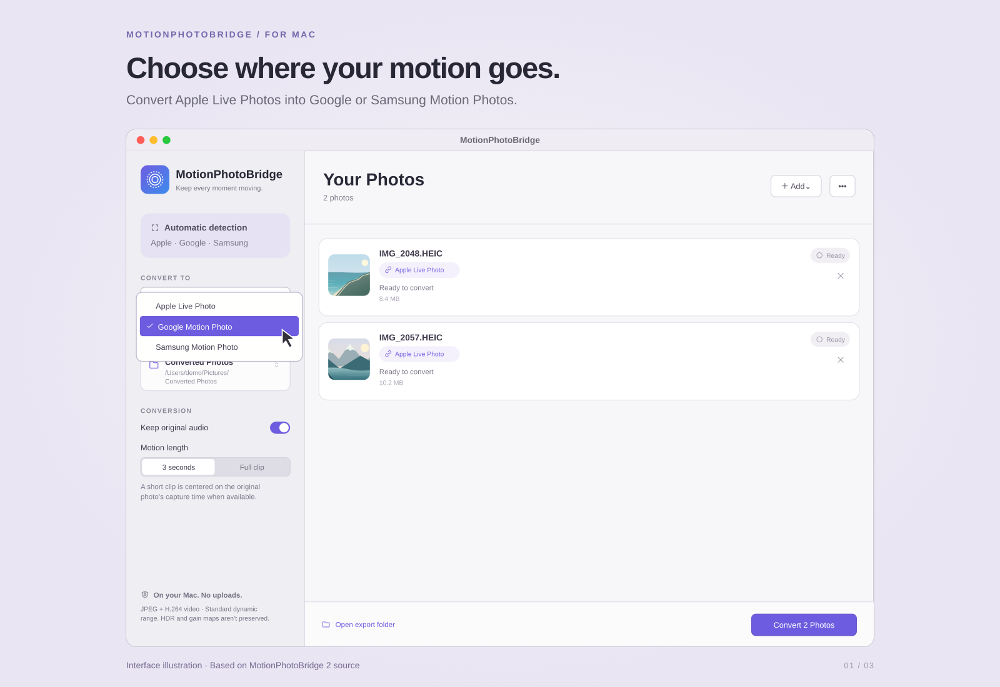
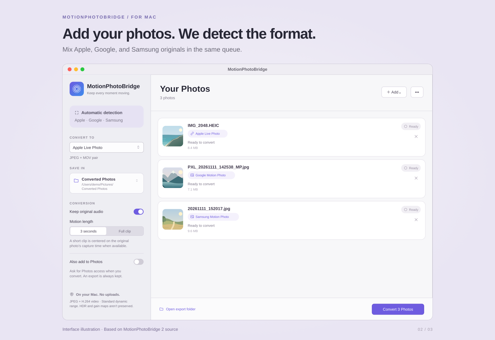
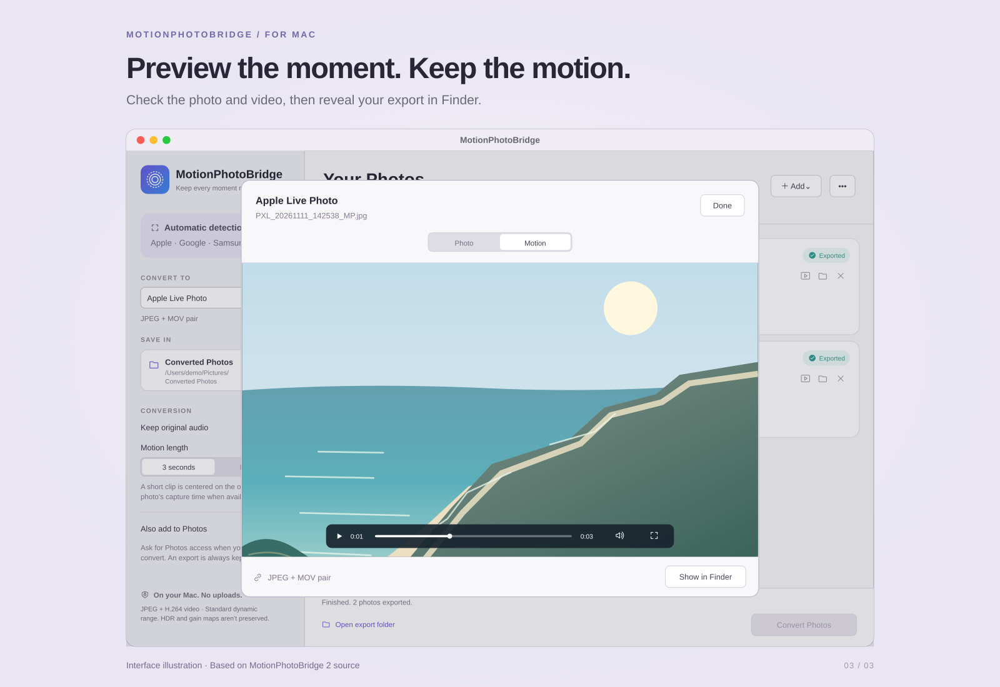

# MotionPhotoBridge

## Keep the motion. Choose the format.

The problem - Android mobile user who uses OSX losing motion functionality within the Mac Photos App.

MotionPhotoBridge is a native Mac app for converting between **Apple Live Photos**, **Google Motion Photos**, and **Samsung Motion Photos**. Bring your original photos, choose a destination, and keep the still image and its moving moment together.

Convert from iPhone to Google or Samsung, from Android to Apple, or between Google and Samsung formats. MotionPhotoBridge detects the source automatically and handles batches of photos in one window.

**macOS 13+ · Native SwiftUI interface · Local processing**

## Interface illustrations

### One input. Choice of outputs.

Choose **Apple Live Photo**, **Google Motion Photo**, or **Samsung Motion Photo** in **Convert To**. The selected format applies to the batch. Keep the audio, turn it off, or choose between a three-second clip and the full motion clip.



### Know what you’re converting

Drop individual originals or add a folder. Each recognized photo gets a source-format badge. Apple’s image and MOV are matched using their embedded identifiers, so renamed originals can still form a pair. If one half is missing, the queue explains what to add.



### Preview, export, and keep going

Check the still image and motion in the preview, then reveal the finished files in Finder. Apple output can also be added to Photos. To make another version, choose a different destination and queue a completed photo again; its previous export stays on disk.



## What you get

| Destination | Exported photo files |
| --- | --- |
| **Apple Live Photo** | A linked JPEG and MOV pair |
| **Google Motion Photo** | One JPEG with an embedded MP4 video |
| **Samsung Motion Photo** | One JPEG with an embedded MP4 video and Samsung motion metadata |

Every conversion gets its own uniquely named folder, plus a small `conversion.json` report with format, timing, audio, and conversion notes. Your original files are never overwritten.

## Get started

### Build the app on your Mac

This project includes source and a build launcher. It does not currently include a precompiled or notarized app.

You’ll need **macOS 13 Ventura or later** and **Swift 5.9 or later with the macOS SDK**, supplied by Xcode 15 or later or compatible Apple Command Line Tools. No third-party Swift packages are required.

1. Download or clone the project, then unzip it if needed.
2. Quit any older copy of MotionPhotoBridge.
3. Double-click **Build MotionPhotoBridge.command**.
4. The launcher builds and opens **dist/MotionPhotoBridge.app**. Move it to Applications if you’d like.

You can also run the launcher from the project folder in Terminal:

```sh
bash "Build MotionPhotoBridge.command"
```

If Apple’s developer tools are missing, run `xcode-select --install` and finish the installer first.

The app uses the bundle identifier `com.motionphotobridge.app`. macOS may ask you to grant Photos permission again after building this version.

### Convert your first batch

1. Add your original motion photos or a folder containing them.
2. Check the detected formats and choose a destination under **Convert To**.
3. Choose an export folder and set your audio and clip-length preferences.
4. Select **Convert**. Preview completed results or open their export folders.

For Apple output, enable **Also add to Photos** if you want the app to import the finished pairs. Exporting alone does not require Photos permission.

### Starting with iPhone Live Photos?

In Photos on your Mac, select the Live Photos and choose **File → Export → Export Unmodified Original**. This produces a still image and a video for each Live Photo. Add both files, or their folder, to MotionPhotoBridge. See [Apple’s export instructions](https://support.apple.com/en-gb/guide/photos/pht6e157c5f/12.0/mac/27).

For Google and Samsung, use original files that still contain their embedded video. An ordinary still image or a copy with its motion removed cannot recreate the missing movement.

## Local by design

Conversion happens on your Mac. MotionPhotoBridge does not upload your photos, use a conversion server, or collect analytics. It creates new files and leaves the originals untouched. Existing iCloud Photos settings may sync items you choose to import into Photos independently of MotionPhotoBridge.

## Quality and compatibility

MotionPhotoBridge keeps the original still photograph and re-encodes it as JPEG, with H.264 motion video and optional AAC audio. It carries across supported dates, location, orientation, and key-photo timing. When a usable timing marker is missing, the middle of the clip is used and the fallback is noted.

Output is **standard dynamic range**. Re-encoding is lossy; HDR, gain maps, depth data, and Photos effects are not preserved. Keep both Apple files together, and transfer Google/Samsung exports as complete files so their embedded motion survives.

**Verification status:** version 2 still needs native macOS build/test and device playback verification. The source includes 100 test cases. See [validation status](docs/VALIDATION.md) for the checks completed so far.

## For developers and testers

```sh
# Run the Swift tests on a Mac.
xcrun swift test

# Test, build for Apple silicon and Intel, and create a DMG.
bash scripts/build-app.sh --test --universal --dmg
```

The tests use generated media and never import test photos into your Photos library. See the [technical guide](docs/TECHNICAL-GUIDE.md) for supported layouts, encoding details, and build options, or the [Mac verification guide](docs/MAC_VERIFICATION.md) for real-device checks.
